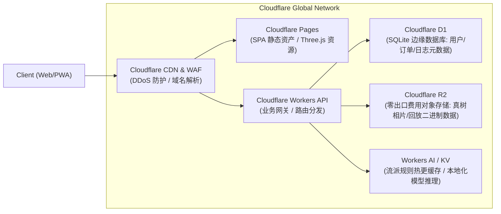

# 《树境·盆景道》（Bonsai Realm: Dojo / 樹境・盆栽道）
## 3D 生长物理引擎、跨文化流派体系与商业化产品设计规格书 (Spec v1.0)

- **主品牌名称**：
  - 中文：**《树境·盆景道》**（定位：日常休闲园艺与造型规划工具）
  - 英文：**Bonsai Dojo: Realms of Growth**（定位：Bonsai Flight Simulator & Styling Studio）
  - 日文：**樹境・盆栽道（じゅきょう・ぼんさいどう）**（定位：盆栽育成シミュレータ＆流派造形）
- **基石文献**：r/Bonsai Wiki《Developing your own trees》（本地副本：`/Developing your own trees.md`）
- **版本状态**：v1.0 (正式设计规格，全决策对齐闭环)
- **代码仓库**：https://github.com/corlin/BonsaiDIY

---

## 1. 核心定位与价值主张 (Executive Summary)

### 1.1 一句话定位
**“盆景界的飞行模拟器”** —— 一套基于植物生理学物理反应（Pałubicki自组织、达芬奇管道模型、碳平衡与修剪反应）与东方/西方跨文化美学语法的 3D 盆景模拟内核。它让初学者在虚拟空间中安全试错、理解“减法艺术”的时间沉淀，建立对植物生长的敬畏，并最终通过数字孪生指引现实中的树木养护。

### 1.2 核心痛点与破解之道 (反思自 r/Bonsai Wiki)
1. **“不可逆性与高时间代价”**：
   - *真实痛点*：盆景是“减法技艺”，剪掉的枝接不回去，每去除非理智的 20% 树体，相当于损失一整年的生长。新手常因一刀之错毁掉多年老桩。
   - *产品破解*：**道场模式（Dojo Mode）**，支持无限次预演“当前修剪决策在 1 年、3 年后的长势”，提供自由快进与撤销，建立“下棋般的长远推演能力”。
2. **“初学者认知偏差”**：
   - *真实痛点*：迷恋从种子种起、过早上盆（导致树木停滞生长）、为看树干剃光内膛枝、修剪成圆球形（Pom-pom）绿云。
   - *产品破解*：**规则教练系统（Rule Coach）**，基于 Wiki 提炼出的硬核法则（如 6:1 高径比、最低枝高度、针叶树禁忌等），在 3D 视口内实时高亮失误并给出植物学解释。
3. **“跨文化审美割裂”**：
   - *真实痛点*：日式重姿態法度（模样木/文人木），中式重意境与因势利导（岭南派蓄枝截干、川派身法），西方重自然造化（Naturalistic）。新手缺乏系统认知。
   - *产品破解*：**三层盆景语法（L1/L2/L3）**，实现“同一棵原材，三种流派对照”，切换流派即切换造形导师与演进终局。

---

## 2. 系统核心架构 (Architecture Overview)

系统采用**“内核确定性与渲染/表现解耦”**的设计哲学，确保物理模拟、多端一致性与长效跨平台演进。

```mermaid
flowchart TD
    subgraph Data["数据与规则驱动包 (JSON/YAML)"]
        SP_DATA["树种生理参数表\n(顶端优势/回芽率/耐剪度/水肥响应)"]
        ST_DATA["流派美学语法表\n(日式模样木/岭南蓄枝/自然派)"]
        RULE_DATA["Wiki 专家规则库\n(R-PROP, R-PRUNE, R-SEASON...)"]
        I18N_DATA["多语言术语对照表\n(zh-CN / ja-JP / en)"]
    end

    subgraph Core["跨平台 Rust 模拟内核 (Deterministic Core)"]
        L1["L1 植物生理物理层\n(芽命运/Borchert-Honda资源/管道模型/能量池/年周期)"]
        L2["L2 园艺技法层\n(剪枝/截干/蟠扎定型/牺牲枝增粗/提根换盆)"]
        L3["L3 审美语法与评判层\n(空间轮廓/动势/枝序/黄金比例/流派语法约束)"]
        DIAG["规则诊断引擎\n(输出纯结构化 JSON: Issue, Severity, EvidenceNodeId)"]
        
        Data --> Core
        L2 --> L1
        L1 --> L3
        L1 & L3 --> DIAG
    end

    subgraph Runtime["多端渲染适配层 (Presentation Layer)"]
        WEB["Web/PWA (首发)\nThree.js + WebGL2/WebGPU"]
        UNITY["Unity 移动原生 (指标触发)\niOS / Android C ABI FFI"]
    end

    subgraph Infra["Cloudflare 全球边缘架构"]
        CF_PAGES["Cloudflare Pages\n前端 SPA/PWA 托管"]
        CF_WORKERS["Cloudflare Workers\n无服务器逻辑 API"]
        CF_D1["Cloudflare D1 / Hyperdrive\n用户档案 / 操作日志索引"]
        CF_R2["Cloudflare R2\n真树日志图床 / 3D 回放快照"]
        CF_KV["Workers KV / Cache\n流派配置热更 / 诊断缓存"]
    end

    subgraph LLM_Gateway["AI 表达层 (Presentation Adapter)"]
        GLOBAL_EXPR["海外版：受约束 LLM (Cloudflare Workers AI / OpenAI)\n自然语言导师点评与知识库检索"]
        CN_EXPR["中国版：专家文案模板库 / 已备案大模型\n合规文字建议 (非打分)"]
    end

    Core -->|WASM 编译| WEB
    Core -->|C ABI 静态/动态库| UNITY
    DIAG --> LLM_Gateway
    WEB & UNITY <--> Infra
    LLM_Gateway <--> Infra
```

---

## 3. L1/L2/L3 植物生理与流派理论构建 (Theoretical Construction)

### 3.1 L1 植物生理学模拟机制（理论支柱）
依据经典植物生理计算模型与 Wiki 经验公式：
1. **芽级自组织生长 (Pałubicki et al. 2009)**：
   - 树木拓扑表示为有向无环图（DAG），节点为节间（Internode）与芽（Bud）。
   - 芽分为顶芽、侧芽与潜伏芽。每个生长周期内，光照穿透度（通过八叉树体素空间阴影投射计算）与内部资源分配共同决定芽是萌发新枝、保持休眠或萎缩枯死。
   - *解释真实法则*：树冠密闭后，内部内膛枝和底部下枝因光通量低于补偿点而自然枯萎（对应“切忌剪光下枝”）。
2. **顶端优势与资源分配 (Borchert & Honda 1984)**：
   - 能量分配遵循极性运输模型，顶芽分泌生长素向下运输抑制侧芽，基部根系吸收的根压与养分优先供给顶端优势枝。
   - *解释真实法则*：若不进行“平衡修剪（Balance Pruning）”，顶枝将爆发式生长抽条，底枝迅速衰竭。
3. **达芬奇法则与管道模型 (Shinozaki et al. 1964, Pipe Model Theory)**：
   - 任意母枝截面积等于其所支持的所有子枝截面积之和：$A_{parent} = \sum A_{children}$。
   - 树干和主枝的粗度由其上端挂载的活跃叶量（蒸腾面积）驱动生长。
   - *解释真实法则*：利用**“牺牲枝（Sacrifice Branch）”**放任其狂长以快速催粗基部树干（Trunk Tapering），成型后切除。
4. **创伤修复与潜伏芽萌发反应 (Harvard Arnoldia 理论)**：
   - 当主干或主枝被切断（Trunk Chop）时，顶端优势瞬间阻断，切口下方的能量富集与激素激增，激活木质部周边的潜伏芽（Back-budding）。
   - *解释真实法则*：岭南派“蓄枝截干”与阔叶树 clip & grow 的科学本质。
5. **蟠扎力学与黏弹性定型模型**：
   - 枝条引入抗弯刚度与弹性极限。施加铝丝/铜丝后产生塑性形变。
   - 随着木质部维管形成层的季节性分裂增厚，弯曲状态被永久锁入新生木质化细胞中；若超时未拆线，增粗的树皮将包裹金属丝形成不可逆的**“嵌线伤痕（Wire Bite）”**。
6. **碳水化合物能量平衡池与休眠周期**：
   - 全树维护一个整体非结构性碳水化合物（NSC）储备池。春季萌发消耗储备，夏季叶片光合作用盈余回流根部，秋季积累防冻，冬季需经历足够的低温冷积温（Chilling Hours）方能打破休眠。
   - *解释真实法则*：温带树木（松、柏、枫、榆）在室内过冬必因耗尽碳水化合物衰竭而亡（打破“室内盆景”神话）。

### 3.2 L2 园艺技法库
- **回缩剪 (Heading Back)**：截断枝条先端，保留侧枝或外向芽，削弱优势，促生分枝。
- **疏剪 (Thinning Out)**：从基部彻底切除多余无用枝，改善内膛通风透光。
- **截干 (Trunk Chop)**：高位截断主干，选定侧生幼枝作为新主干梢，形成显著的粗细过渡（Taper）。
- **金属丝蟠扎与矫正 (Wiring & Bending)**：设定铝丝粗度（1.0mm–5.0mm），调整空间曲线。
- **换盆与提根 (Repotting & Root Pruning)**：修剪烂根、过长主根，促发须根，上提露根（Nebari）。

### 3.3 L3 流派美学语法与跨文化映射
| 维度 | 日式传统姿態（模样木 Moyogi） | 岭南派（大树型/蓄枝截干） | 西方自然派（Naturalistic） |
|---|---|---|---|
| **核心美学哲学** | 禅意、克制、不对称平衡、法度严谨 | 旷野苍劲、一波三折、生机勃发、因势造化 | 顺应天道、岁月风蚀痕迹（Deadwood） |
| **主干构型约束** | 明显的“之”字形三维弯曲，主干逐级收尖 | 节间极短、顿挫有力、鸡爪枝/鹿角枝层叠 | 保留原生不规则走势，凸显风雨雷击神枝（Jin/Shari） |
| **出枝规范** | 第一主枝、第二副枝、后背枝（Depth branch）界限分明 | 顺应原木胚势，讲求“蓄一节、截一节”，枝段比例协调 | 依照野生老树结构，枝片自然延展，反对刻板几何化 |
| **叶层形态** | 紧致平整的三角形云片构图（Foliage Pads） | 疏密相间，透光见骨，枝托呈伞状聚拢 | 散状树冠，注重整体生命气场与季节变迁 |
| **Wiki 技法映射** | 严格的比例控制（6:1）与铝丝蟠扎定位 | **Clip & Grow（剪了再养）**的极致东方版本 | 尊重原生物质，采掘老桩（Yamadori）后的减法还原 |

---

## 4. 产品模式、游戏循环与双版本设计

### 4.1 核心双模式
```
[ 用户入口 ]
    ├── 道场模式 (Dojo Mode) ──【研习/试错】
    │     ├── 6-8 个循序渐进的流派教学关卡
    │     ├── 无限撤销 (Undo/Redo)
    │     ├── 时间穿梭机：一键预演 1年/3年 物理推演
    │     └── 结构透视镜：拨开叶簇，按枝序层级彩现骨架
    │
    └── 园子模式 (Garden Mode) ──【长期养成/陪伴】
          ├── 初始提供 2-3 个席位（多树并行，交替作业）
          ├── 真实时间压缩流（默认 1 现实日 = 1 游戏月）
          ├── 操作完全不可逆，遵循真实农历节气窗口
          └── 确定性 3D 成长全记录，支持一键导出时空穿梭回放
```

### 4.2 双版本地域差异化（合规与功能矩阵）
为确保中国市场作为**日常休闲园艺与生活规划工具**的合法合规，系统通过 Cloudflare 边缘环境特征与配置开关进行功能解耦：

| 功能模块 | 海外版 (Global Web/PWA) | 中国版 (China Web/PWA 工具版) |
|---|---|---|
| **产品属性定位** | 模拟游戏 + 艺术工坊 (Simulation Game) | 日常园艺修剪规划与植物日志 (Utility & Life) |
| **道场模式** | 全功能 + 关卡完成度评分 | 全功能，但**不予打分评级**，仅提供专家改善建议 |
| **园子模式** | 虚拟盆景放置、虚拟成就徽章、庭院装饰 | **关闭虚拟养成游戏化**；转为“真树数字化档案沙盘” |
| **真树日志功能** | Pro 会员专享 | **核心基础功能**（拍照建档、生长节点记录、防冻提醒） |
| **AI 导师点评** | LLM 交互式生成评语，支持追问 | **人工专家模板库 / 国内合规大模型**，仅给园艺建议 |
| **变现模式** | Pro 订阅 + 终身买断 + 陶艺家盆器内购 | **纯工具与专家知识库订阅**（去虚拟道具商城） |

---

## 5. 商业化闭环与竞争壁垒 (Business Model & Moat)

### 5.1 阶梯商业变现体系
1. **免费层 (Free Access)**：
   - 道场模式前 3 关基础修剪指引；
   - 体验榆树（阔叶）的单年剪枝萌发；
   - 基础真树相册（支持记录 2 棵真实植物）。
2. **“Sensei Pro” 增值订阅**：
   - 定价：**\$4.99/月 或 \$39.99/年**（海外）；**终身买断 \$59.99**。中国区对应本土化知识工具订阅费（约 ¥18/月，¥148/年）。
   - 权益：解锁针叶树（刺柏）及后续全树种库；无限次“1年/3年物理推演”；解锁三流派全部高级造形语法库；真树无上限云端高精相册与智能养护日历。
3. **真实世界电商导购佣金 (Affiliate Commerce)**：
   - 基于用户输入的地理位置/USDA 气候分区，在真树日志或导购入口内智能匹配并推荐“适合您气候的树种素材胚”、“专业兼进级剪刀”、“高山赤玉土”、“防锈铝丝”，导流至合作品牌商或亚马逊，抽取 **5%–15%** 联盟佣金。
4. **数字陶艺家联名 (Artisan Collab - 仅海外版)**：
   - 签约真实知名盆景陶艺家（如 Sara Rayner、Chuck Iker 等），1:1 数字建模盆器。用户购买虚拟名盆装点作品，销售额与陶艺家 5/5 分成。

### 5.2 四重不可复制的竞争壁垒
```
[ 竞争壁垒进化阶梯 ]
  ▲
  │  第 4 级：渠道与大师联盟 (Mirai, 中国盆景协会, 大宫盆栽村权威联名与工作坊绑定)
  │  第 3 级：数据飞轮 (数万名玩家上传的“真实树木照片 - 预演路线 - 真实长势”横跨数年的独家数据集)
  │  第 2 级：社区网络效应 (确定性 3D 演变回放视频在社交平台的自发病毒裂变)
  └──第 1 级：知识壁垒 (独家可解释的“L1生理物理 + L3三流派审美语法”可量化数学规则库)
```

---

## 6. MVP 范围界定与交付规范 (Scope of MVP)

### 6.1 MVP 包含清单
1. **树种支持 (2 种)**：
   - **榆树 (Chinese Elm)**：验证阔叶树顶端优势、回芽能力、蓄枝截干（Clip & Grow）。
   - **刺柏 (Juniper)**：验证针叶树鳞叶生长、铝丝蟠扎塑形、叶片全剪整枝死亡法则。
2. **素材规格**：
   - 程序化生成的苗圃初级胚桩（包含随机主干弯曲度、初始主枝分布、根盘 Nebari 缺陷，还原真实挑树体验）。
3. **技法核心 (L2)**：
   - 回缩剪、疏剪、主干截断、铝丝缠绕与曲折拉引、牺牲枝保留、基础换盆。
4. **流派语法 (L3)**：
   - 日式模样木、岭南蓄枝截干、西方自然派；支持一键切换视角进行“跨文化美学审定”。
5. **体验模式**：
   - **道场**：6 个实训关卡（认识萌发、控制优势、截干造型、走势定向、三流派对比等）。
   - **园子 (海外)**：最多 3 棵树的并行自然流淌。
   - **真树日志 (中国为主)**：本地拍照、节气打卡、养护日记。
6. **技术与平台**：
   - Web/PWA（适配移动触屏单指旋转、双指平移、精准点选截枝）；
   - 中、英、日三语全套 UI 与流派术语；
   - 确定性 3D 回放分享（通过 URL 参数还原全部修剪操作种子与步骤）。

### 6.2 明确砍掉/后续迭代的功能（Non-Goals for MVP）
- 种子育苗模式（Wiki 明确定义为反模式，坚决不做）；
- 山采（Yamadori）大型户外探险游戏机制；
- 复杂的木质部雕刻（神枝 Jin / 舍利干 Shari）手动微雕（MVP 采用预设破损状态）；
- 移动端 Unity 原生 App（待达成触发指标后再启动）。

---

## 7. 全球边缘基础设施与数据合规 (Cloudflare Infra)

所有云端服务完全统一构建于 **Cloudflare 边缘生态**，极度简化运维，确保全球极低时延与成本弹性：



### 7.1 统一合规与鉴权设计
- **匿名体验优先**：初学者无需注册即可直接进入道场模式操作，操作日志写入浏览器 IndexedDB。
- **渐进式绑定**：触发跨设备同步、购买 Pro 或发布分享时，海外调用 Google/Apple 授权，国内支持手机短信/微信免密鉴权。
- **数据出境与境内隔离策略**：
  - 中国区用户真树相片与操作档案在 R2 中开辟专门的地域性存储桶（Regional Bucket），并使用独立的合规解析子域名。
  - AI 导师表达层在中国区默认切换为纯规则引擎模板输出，杜绝未经审查的模型输出法律风险。

---

## 8. 开发路线图、预算与指标驱动演进 (Roadmap & Metrics)

### 8.1 4 个月紧凑型研发时间表
- **M0（第 1–3 周）· 玩法原型与手感验证**：
  - TypeScript 原型快速验证 3D 空间下“剪枝、蟠扎”的交互手感与视觉透视；
  - 美术定调“风格化写实”Shader 与中日西 3 种文化背景 Demo；
  - 签约第 1 位兼职盆景学术顾问（资深俱乐部主理人），审校生理公式。
- **M1（第 4–8 周）· Rust 物理内核与榆树闭环**：
  - 编写 Rust 生长引擎（L1+L2），编译为 WASM 并与 Three.js 管道打通；
  - 跑通榆树的“修剪 - 回芽 - 增粗”确定性数学循环。
- **M2（第 9–12 周）· 针叶模型、三流派与规则引擎**：
  - 加入刺柏树种生理模型；
  - 编码 L3 三大流派美学语法，完成结构化 JSON 规则诊断引擎；
  - 制作道场模式 6 大关卡与 3D 骨架透视模式。
- **M3（第 13–16 周）· 双版本适配、Cloudflare 部署与三地上线**：
  - 园子模式与真树日志开发；
  - Cloudflare 全套服务部署上线；完成中日英本地化；
  - 海外与中国双版本功能开关上线，全网社群自传播冷启动。

### 8.2 研发预算估算（2–4 人精干团队）
- 人力成本（4 个月）：约 40–60 万元人民币（核心系统开发 + 3D风格化美术 + 前端工程师）。
- 外部顾问与美术专项外包：约 5–10 万元人民币。
- 基础设施与 API 成本（Cloudflare + AI API）：约 5,000–10,000 元（依托 CF 免费与弹性套餐，极低支出）。
- **总启动预算**：约 **50–75 万元人民币**。

### 8.3 Unity 迁移与阶段演变触发条件 (Gate to Unity)
当 Web/PWA 版上线后达成以下**定量指标**时，正式立项启动 Unity 跨平台移动原生版（复用 Rust 核心库）：
1. 资深盆景师 H1 真实性盲测评分稳定 **≥ 4.0** 分；
2. 累计注册用户突破 **20,000** 人，或月活活跃用户 (MAU) 突破 **5,000** 人；
3. 海外 Pro 订阅与买断产生健康的正向现金流；
4. 移动端网页用户中对“原生 App 手势优化”与“离线养护”的呼声成为主导需求。

---

## 附录：Wiki 规则引擎可执行逻辑对照表 (Rules Baseline)

| 规则编码 | 触发时机 | 规则约束逻辑与植物学理由 | 违规后果与教练诊断 |
|---|---|---|---|
| **R-PROP-01** | 全周期 | 树干地径与成型高度比需维持在 **1:6 黄金比例** 附近。 | 高度失控警报：“此树过高而干身偏细，缺乏老树苍古气象，建议截干矮化。” |
| **R-PROP-02** | 造型期 | 最低第一主枝的出枝点不得高于目标设计高度的 **1/3**。 | 比例失调警报：“第一主枝出枝过高，重心上浮，将破坏下盘稳重感。” |
| **R-PRUNE-01** | 剪枝时 | 优先回缩修剪而非直接基部去枝，由外向内逐步回缩。 | 严厉警告：“不可逆切除！靠近主干的次级内膛枝是未来枝托回缩的命脉。” |
| **R-PRUNE-03** | 刺柏修剪 | 刺柏枝条严禁将前端鳞叶完全剃光。 | 树木受损警报：“针叶树枝条无叶则无法回流养分，此枝在下一季度必枯死。” |
| **R-PRUNE-05** | 单季剪枝 | 单次操作修剪量不得超过整树绿色生物体量的 **20%**。 | 树势虚弱提示：“大幅度过度修剪导致光合骤降，树木将陷入 1-2 年回缩衰退期。” |
| **R-HEALTH-01**| 养护期 | 严禁对刚经历换盆或长势弱的病树进行重度蟠扎与强剪。 | 死亡风险阻止：“弱树需在培养土或大木箱中恢复树势，此时动刀将致植株衰亡。” |
| **R-SEASON-01**| 节气驱动 | 重度截干与洗根换盆只能在早春休眠即将苏醒时进行；拆线宜在秋后。 | 季节惩罚：“在盛夏或深冬伤根将导致水分代谢失衡，操作已造成树皮不可逆损伤。” |
| **R-BALANCE-01**| 平衡修剪 | 剪强留弱：仅抑制并剪短顶端极强势枝，放任中下部弱枝生长。 | 平衡失效警报：“未对优势枝进行回缩，下部托枝将因缺乏养分在来年自然枯落。” |
