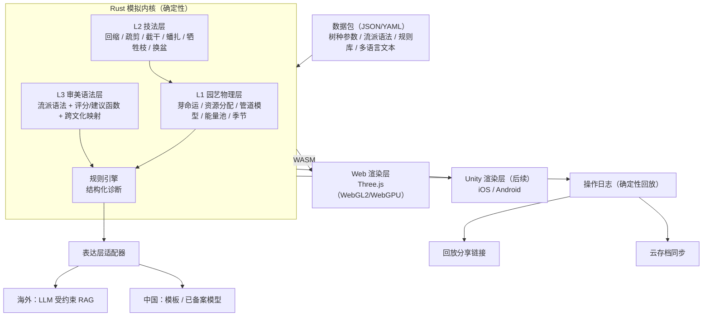

# Bonsai DIY —— 盆景飞行模拟器 设计规格（Spec）

- 版本：v0.1（访谈进行中，已确认决策 Q1–Q15）
- 日期：2026-11-02
- 理论来源：r/Bonsai Wiki《Developing your own trees》（本地副本：`/Developing your own trees.md`）
- 竞品调研原始记录：见附录 B

---

## 1. 一句话定位

**“盆景界的飞行模拟器”**：一套基于真实园艺物理与多文化流派审美的 3D 盆景模拟内核，先让初学者在虚拟中安全地犯错、学会规划，再连接到他们的真树。

## 2. 问题与洞察（来自 Wiki 的理论依据）

| Wiki 事实 | 产品洞察 |
|---|---|
| 盆景是**减法艺术**，不是生长技术；“买树干，养枝叶” | 核心交互是修剪/蟠扎/取舍，不从种子开始 |
| 剪掉的枝**接不回去**；每去除 20% 体量 ≈ 一年生长 | 不可逆 + 高代价 → 预演/模拟有真实价值 |
| “像下棋一样提前规划”“先画出设想图” | 爱好者天然需要“先模拟再动手” |
| 回缩/成型以“年”计（Walter Pall 表：8–22 年） | 时间压缩是游戏化与教学的核心杠杆 |
| “多养几棵树”“同一棵树一年只做一次大动作” | 多树并行填满等待期 |
| 初学者固定错误模式（剪下枝、“看树干”、pom-pom、2D 化、过早上盆） | 可编码为规则引擎与教练反馈 |
| 年度生长周期（春发根/萌发、夏硬化、夏末二次生长、秋发根、冬休眠） | 季节窗口 → 自然的回访钩子与操作时机教学 |
| 6:1 高径比、最低枝 ≤ 目标高度 1/3、目标高度通常 ≤ 原株 1/2 | 可量化的审美/比例约束 |

## 3. 已确认决策总表

| # | 决策点 | 结论 |
|---|---|---|
| Q1 | 产品形态 | **A+B**：大众休闲模拟（A）+ 爱好者规划工具（B）共享一个内核；不对外授权引擎 |
| Q2 | MVP 第一核心用户 | **初学者/准入门者**（A 与 B 的交集） |
| Q3 | 首发平台 | **Web / PWA**（触屏优先）；后续引入 **Unity** 转移动端原生 |
| Q4 | 团队规模 | **2–4 人小团队**，有启动资金 |
| Q5 | 内核架构 | **Rust 内核** → WASM（Web）+ 原生库 C ABI（Unity）；渲染层可替换；先做 2–3 周一次性 TS 玩法原型（默认纳入，可否决） |
| Q6 | 时间模型 | **双模式**：道场（自由快进/预演/撤销）+ 园子（压缩实时、不可逆、多树并行），压缩比默认 1 现实日 ≈ 1 游戏月，服务端可调 |
| Q7 | 商业模式 | **免费增值订阅（Sensei Pro）+ 装饰内购（陶艺家分成）+ 按气候区的现实导购分成**；不卖时间加速；提供终身买断 |
| Q8 | 市场 | **中、日、英**；建立文化特有 + 跨文化流派体系 |
| Q9 | 流派建模 | **三层“盆景语法”**：L1 园艺物理（全球共享）/ L2 技法（共享库 + 流派权重）/ L3 审美语法（声明式、文化特有 + 跨文化映射）；规则先行、ML 后补 |
| Q10 | 上线节奏 | **三地同步上线** |
| Q11 | 中国版形态 | **盆景学习与规划工具**（非游戏）：去除养成/评分/成就/等级/虚拟内购；以知识与工具订阅收费；上线前需国内律师确认 |
| Q12 | 生长模型 | **芽级自组织混合模型**（详见 §6） |
| Q13 | AI 教练 | **规则引擎判定 + LLM 仅做表达**；中国区表达层可替换（模板 或 已备案国内模型） |
| Q14 | 壁垒优先级 | **知识壁垒 → 社区网络效应 → 数据飞轮**，渠道联盟全程加速 |
| Q15 | MVP 范围 | 见 §9 |

## 4. 用户与价值主张

### 4.1 主用户画像（MVP）
- **准入门/刚入门的初学者**：被盆景吸引，怕把树养死、剪坏；在 r/Bonsai、YouTube、小红书、日本 SNS 寻求指导。
- 核心痛点：试错成本以“年”计；求点评等待长、质量参差；不懂季节时机与流派差异。

### 4.2 延伸用户
- A 线：cozy 休闲玩家（被跨文化美学与“养一棵树”的情绪价值吸引）。
- B 线：已有真树的爱好者（预演、日志、流派指导）——中国版的主力。

### 4.3 价值主张
1. **安全试错**：道场里剪错可撤销，并看到 1 年 / 3 年后的后果。
2. **有人告诉我错在哪**：可解释的规则教练 + 3D 标注。
3. **同一棵树，三种审美**：跨文化流派对照，全市场独有。
4. **从虚拟到真实**：气候区匹配的树种/素材推荐、真树日志。

## 5. 系统架构



### 5.1 关键架构原则
- **内核与引擎无关**：内核只输出拓扑与几何数据（枝段、半径、叶簇、健康值、诊断），渲染层只负责“画”。
- **确定性**：定点数/受控浮点 + 种子随机数；同一初始状态 + 操作序列在 Web 与 Unity 结果逐位一致。
- **存档 = 操作日志**：支持回放分享、云同步、防作弊；内核版本化，日志带内核版本号。
- **数据驱动**：树种参数、流派语法、规则库、文案均为数据包，可热更新、可由顾问审阅。
- **功能开关**：海外版 / 中国版通过 feature flags 区分（中国版关闭养成、评分、成就、虚拟内购）。
- **i18n 第一天内建**：zh-CN / ja-JP / en；流派术语表三语对照。

## 6. L1 生长模型（理论构建）

| 机制 | 理论来源 | 对应 Wiki 现象 |
|---|---|---|
| 芽命运（萌发/休眠/死亡），受光照与资源竞争驱动 | Pałubicki et al. 2009, *Self-organizing tree models* | 内膛/下枝见光少而衰弱；“别剪下枝和内膛枝” |
| 资源分配，顶端优势参数化 | Borchert & Honda 1984 | 强枝越强 → 平衡修剪 |
| 枝径由支撑叶量决定（管道模型 / 达·芬奇法则） | Shinozaki et al. 1964 | 让它长才会粗；牺牲枝增粗；收尖 |
| 去顶解除抑制 → 回芽 | Harvard Arnoldia, *Plant response to pruning cuts*（Wiki 引用） | clip & grow / 蓄枝截干 / 截干后发芽 |
| 能量储备池（碳平衡简化） | 简化碳平衡 | 20% 体量 ≈ 一年；病树勿动；回缩期 |
| 蟠扎塑性形变（定型时间、嵌线留疤） | 简化黏弹性模型 | 赋予动势；及时拆线 |
| 季节驱动 | Wiki “年度生长周期” | 春换盆、秋拆线等操作窗口 |

- 规模：每棵树约数千节点的芽/枝段图；每游戏月一次更新；WASM 可在移动浏览器实时预演 3 年。
- 树种参数：顶端优势强度、回芽能力、耐修剪度、蟠扎定型速率、针叶/阔叶芽型等，顾问可读可校准。
- **MVP 需两套芽型**：阔叶（榆）与针叶（刺柏，含“剪光叶整枝死亡”规则）。

## 7. 流派体系（L3 审美语法）

- 每个流派 = 一份声明式“风格语法”：比例约束、枝序规则、轮廓目标、禁忌、建议/评分函数。
- **L3 受 L1 约束**：审美目标不得违背园艺物理（能量不足时树会如实受伤/回缩）。
- **跨文化映射表**示例：Wiki “clip & grow” ≈ 岭南“蓄枝截干”；西方 foliage pad 结构 ↔ 扬派“云片”。
- 流派库（长期）：日式树形分类（直干、模样木、斜干、悬崖、文人木、箒立、寄植…）；中国流派（岭南、扬派、川派、苏派、海派、徽派、通派…）；西方自然派等。
- **权威性**：每个流派与该派认证从业者/协会共建并署名；共建产出的知识产权归平台，大师享署名与分成。

## 8. AI 教练

```
内核状态 → 规则引擎（L3 语法 + Wiki 规则）→ 结构化诊断
  {issue, severity, evidence: segment_id, style}
→ 表达层：海外 LLM（受约束 RAG，仅翻译诊断 + 引用知识库）/ 中国 模板或已备案模型
→ 3D 高亮标注 + 三语解释
```
- 判定权永远在规则引擎；LLM 不得给出与诊断冲突的建议；超出范围时回答“建议咨询本地盆景俱乐部”。
- 免费层：模板表达；Pro：LLM 表达（MVP 不含追问）。
- 中国版：仅给文字建议，不输出分数/等级。

## 9. MVP 范围

| 维度 | MVP 包含 | 推迟 |
|---|---|---|
| 树种 | 榆（阔叶）、刺柏（针叶） | 三角枫、黄杨、松、雀梅等 |
| 素材 | 程序生成苗圃素材（随机优缺点，对应 Wiki 清单）；无种子起步 | 山采、空中压条 |
| 技法 L2 | 回缩、疏剪、截干、蟠扎/拆线、牺牲枝、换盆 | 摘叶、雕刻（神/舍利）、嫁接、压条 |
| 流派 L3 | 日式模样木、岭南蓄枝截干、西方自然派 + 跨文化对照视图 | 其余流派、共建平台 |
| 模式 | 道场 6–8 课（快进/预演/撤销）；园子 ≤3 棵（压缩实时） | 园子扩容、展会评比 |
| AI 教练 | 规则诊断 + 3D 标注；海外 LLM 表达；中国模板 | 追问、审美 ML |
| 社区 | 发育回放分享链接（网页直开） | 点评、挑战赛 |
| 商业化 | Pro 订阅 + 终身买断；少量陶艺家盆器 | 导购分成（MVP 仅放入口测点击率） |
| 真树 | 真树日志（拍照/时间线/提醒）——中国版与 Pro | 照片描骨架数字孪生 |
| 平台/语言 | Web/PWA；中日英；海外版/中国版功能开关 | Unity 移动原生 |

**范围压缩预案（如需再砍，按序）**：① 陶艺家盆器 → ② 园子模式（仅留道场）→ ③ 最后才砍流派数量。

## 10. 商业模式

| 层 | 海外版 | 中国版 |
|---|---|---|
| 免费 | 道场基础课、园子 2–3 棵、初学者树种 | 基础知识库、预演次数有限、真树日志基础版 |
| 订阅 | Sensei Pro ≈ \$4.99/月 / \$39.99/年；终身买断 ≈ \$59.99 | 知识与工具订阅（价格待本地化定价） |
| 装饰内购 | 盆器/几架/展示场景，陶艺家分成 | **不提供** |
| 导购分成 | 按 USDA 气候区推荐真实树种/工具/铝丝/用土（MVP 仅测入口） | 后续评估 |
| B2B（第二阶段） | 俱乐部/教师班级版 | 协会/教学机构 |

- 红线：**不出售时间加速**。

## 11. 竞争格局与壁垒

### 11.1 竞品格局（2026-11 调研）
- A 线 cozy 游戏：**Bonsai Life**（2026-10-15，\$10.99，苗圃经营生活模拟）、**Bonsai Island**（Q1 2027，宣称“fully simulated bonsai”）——赛道升温，纯 cozy 无差异。
- B 线教育/工具：**Mirai Mobile**（Ryan Neil，394 评分）——最强教育对手/潜在合作方；Bonsai Album（\$7.99，194 评分）、BonsaiDo（136）等日志工具。
- 美区盆景专属 App 评分数普遍 < 400 → 品类无头部。
- 无竞品同时具备：真实园艺物理 + 规则教练 + 流派体系 + 真树预演。

### 11.2 壁垒路线
1. **知识壁垒**（先）：与流派权威独家共建、署名的审美语法与规则库；真实案例校准的树种参数。
2. **社区网络效应**（次）：确定性回放分享、“同一棵树三种流派”对照内容、挑战赛。
3. **数据飞轮**（后，但 MVP 即埋点）：真树日志 + 预演 + 实际结果的纵向数据，校准模型、训练审美 ML。
4. **渠道联盟**（全程）：Mirai、Bonsai Empire、各地俱乐部、中国盆景艺术家协会、日本盆栽协会（名称待核实）、陶艺家。与 Mirai 定位为“教学视频的练习场”（互补，不替代）。

## 12. 合规与风险（需专业意见，非法律建议）

- 中国：游戏认定以实际功能为准；中国版须在功能上真正属于工具/教育类。生成式 AI 服务监管（备案/安全评估）、社区内容审核、个人信息保护与数据出境/本地存储均需国内律师意见。
- 日本：内容权威性风险——必须有日本本土盆栽顾问把关。
- 模拟可信度：未经真实案例校准会被老手识破 → 顾问第 1 个月介入。
- 订阅接受度：cozy 用户反感订阅 → 终身买断选项 + 实测转化。
- 范围风险：三语 × 三流派 × 双版本对 2–4 人团队负担重 → 见 §9 压缩预案。
- 人才/合作风险：大师被挖或解约 → 合同明确知识产权归属。

## 13. 待决事项（访谈继续中）

以下问题尚未与用户确认，将逐一访谈后补入本 Spec：
1. MVP 成功指标与验证假设（留存、转化、分享率阈值）
2. 美术风格与视觉方向
3. 时间线与里程碑、预算区间
4. 盆景顾问/流派合作方的获取路径（中日英各一）
5. 品牌命名（三语）
6. 冷启动与增长打法（各市场渠道）
7. 数据与隐私策略（账号体系、存储地域）
8. Unity 迁移触发条件

---

## 附录 A：Wiki 规则 → 规则引擎条目（首批）

| 规则 ID | 规则 | 来源段落 |
|---|---|---|
| R-PROP-01 | 目标高度 ≈ 6 × 树干直径 | Simple raw-plant… pruning advice |
| R-PROP-02 | 最低枝起点 ≤ 目标高度 1/3 | 同上 |
| R-PROP-03 | 目标高度通常 ≤ 原株 1/2 | 同上 |
| R-PRUNE-01 | 优先回缩而非去除枝条 | 同上 |
| R-PRUNE-02 | 由外向内修剪 | 同上 |
| R-PRUNE-03 | 刺柏枝条不得剪光叶片 | 同上 |
| R-PRUNE-04 | 不剪除靠近树干的二/三级枝 | 同上 |
| R-PRUNE-05 | 单次去除体量预警（每 20% ≈ 一年生长） | 同上 |
| R-MISTAKE-01..08 | 初学者错误：暴露树干线、误判风吹/悬崖、矫正倒收尖伤树、为看树干去枝、过度去叶成 2D、pom-pom 枝片、剪除下枝 | Beginner mistakes with pruning |
| R-HEALTH-01 | 病弱树不做造型 | DOs and DON'Ts |
| R-HEALTH-02 | 同一棵树一年内不重复大动作；造型与换盆错开 | DOs and DON'Ts |
| R-POT-01 | 未成型不入盆景盆（盆中几乎停止生长） | What are bonsai… / Develop your own |
| R-SEASON-01 | 换盆/大造型/采集在春季窗口；拆线在秋季 | Simplified year in the life of a bonsai |
| R-PRIORITY-01 | 发育优先级：树干/根 → 主枝 → 次枝 → 分枝/叶片缩小 | Develop your own… |
| R-BALANCE-01 | 平衡修剪：只回缩最强的几根枝 | Develop your own… |

## 附录 B：竞品调研原始记录

见 [docs/research/2026-11-02-competitor-scan.md](../../research/2026-11-02-competitor-scan.md)（Steam storesearch API 与 iTunes Search API，2026-11-02，美区）。局限：无下载/营收数据；Reddit 订阅数未核实；中日商店未调研。
